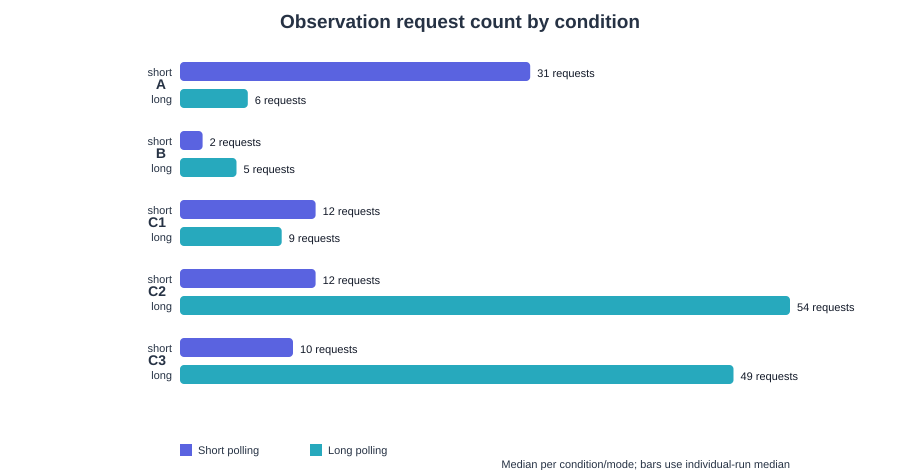
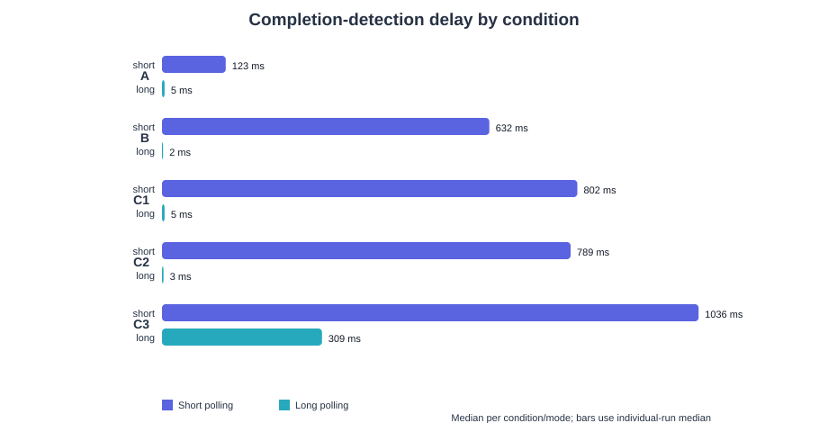

# ImageLab Assessment 2 — Long-polling implementation and comparison

Teryn Guzman & Kelvin Gordon · CMPS 4191

## 1. Predictions and method

**Predictions.** The five predictions in `predictions.md` were committed before any measured run (commit `ad337bd`, 26 Oct 2026 00:06:54 −0600; the first measured server log line is 00:39:41). A pipeline dry run on 25 Oct came earlier; its data was discarded and none of it is in the 30 runs. For each condition and mode we predicted request count, observation database reads and detection delay. Short polling was expected to send about one request per second (A 31–33 requests; B 2–3; C1 and C2 11–13; C3 9–11) with delays of 0–1000 ms. Long polling was expected to send few requests when updates are rare (A 5–7, delay under 50 ms), many when updates are fast (C2 50–60 requests, 100+ reads), and to show a delay of 100–400 ms in C3.

**Implementation.** Each job row in PostgreSQL has a `version` that increases in the same transaction as every observable change (claim, each stored variant, each simulated step, completion or failure). After the commit, the worker publishes a wake-up to every observer subscribed to that job. A long-poll handler (`GET /v1/jobs/{id}?after=N&wait=20`) subscribes **before** its first database read and then loops: read the job; answer at once if its version is newer than `after` or it is terminal; otherwise wait for a wake-up, the 20 s holding deadline, or request cancellation. A wake-up only means "read again", so the database stays authoritative. At the deadline the handler reads once more and returns `204 No Content` only if nothing changed. Subscribing first closes the gap in which a commit could land between the check and the wait.

**Setup.** One computer running Windows 10.0.26300.9711, Go 1.26.6, PostgreSQL 18.6 and Chrome 155.0.8059.86 (64-bit); Python 3.12.0 was used for analysis. The Go API, PostgreSQL and the browser were all local, with one observer, the Chrome tab in the foreground and DevTools open. Every run used the same input, `picture1.jpg` (JPEG, 736 × 1104 px, 118,057 bytes). Each run started only after the previous job had reached Completed and a couple of seconds had passed, and only one job was submitted at a time, so the worker queue was empty at the start of every run. Server flags: A `-quiet-delay=30s`; B none; C1 simulated phase of 10 s at 2 s intervals; C2 and C3 10 s at 200 ms. C3 also used a Chrome DevTools custom profile with 200 ms latency and no bandwidth limit. The measured prompt-GET duration in C3 was 205–220 ms (median 215 ms) against 13–22 ms (median 16 ms) with no throttling, an added delay of about 199 ms.

**Procedure.** 5 conditions × 2 modes × 3 repetitions gave 30 measured runs. The mode order alternated: short then long (repetition 1), long then short (repetition 2), short then long (repetition 3). Short polling waits 1 s after each response (a delay after the response, not start-to-start) with no overlapping requests. Long polling sends its next request immediately after a valid active 200 or a 204 and uses the default 20 s hold. A run is observed from the first GET (the prompt snapshot after the 202) until the terminal representation arrives, so upload time is outside the window. Two earlier attempts at condition A (jobs `e9c04638…` and `28d43985…`) were recorded before server log capture began, so the server log has no records for them, and their client traces are shorter (38 and 16 client events against 94 and 18 for complete runs). They were excluded and repeated. The raw logs are unchanged and the exclusions are listed in `summary.md`.

**Timestamps.** Detection delay is the browser's `Date.now()` at receipt of the full terminal response minus the server's wall-clock `post_commit_at`, logged right after the terminal transaction commits, joined by job ID and version on one computer. The browser clock has 1 ms resolution; the server's clock resolution was not measured separately, and scheduling can add a few milliseconds either way. Processing duration is the persisted `started_at` to `completed_at`, split into artificial delay (the configured quiet delay plus the measured simulated phase) and real processing. Database reads count the SQL statements the observation handler attempted: one for an unfinished job and two for a completed one, which also loads its variants. A waiting long-poll handler does not poll PostgreSQL; it reads at the start, after each wake-up and at the deadline. The worker's own queue polling is not counted.

## 2. Results

Medians of three runs per cell. Detection delay is shown with its minimum–maximum; request counts were identical across repetitions except C3 long (48–49). All 30 runs are in `results/summary.csv` and `results/summary.md`.

| Condition | Requests short / long | DB reads short / long | Detection delay, short (ms) | Detection delay, long (ms) |
|---|---:|---:|---:|---:|
| A — quiet job | 31 / 6 | 32 / 12 | 123 (99–199) | 5 (3–12) |
| B — real progress | 2 / 5 | 3 / 10 | 632 (629–792) | 2 (2–4) |
| C1 — slow updates | 12 / 9 | 13 / 18 | 802 (735–976) | 5 (4–10) |
| C2 — fast updates | 12 / 54 | 13 / 108 | 789 (744–982) | 3 (2–11) |
| C3 — fast, +200 ms latency | 10 / 49 | 11 / 50 | 1036 (1017–1060) | 309 (267–359) |

Real processing time was about 204–300 ms in every run, whatever the mode. 29 of our 30 predicted ranges were met. The one miss was C3 short-polling delay (1036 ms against 500–1000 ms predicted): the one-second wait is followed by a response that now crosses a path with about 200 ms added, so the worst case exceeds one second. Short-polling delays cluster tightly (A short 99–199 ms) because, with only three runs, the polling phase relative to the job's end was similar each time. Each long-polling run in A contained one normal 204 followed by an immediate new request, with no error.

## 3. Interpretation and recommendation

**Where long polling helped.** With a quiet job (A) it cut requests from 31 to 6 and reads from 32 to 12, and 28 of short polling's 31 responses repeated an unchanged version. The browser learned of completion in a median 5 ms instead of 123 ms. In C1 it also reduced requests (9 against 12) and delay (5 ms against 802 ms). In B, where the job takes about 0.2 s, delay fell from 632 ms to 2 ms.

**Where it did not.** In B long polling sent more requests (5 against 2) and reads (10 against 3), because each held request found a new version almost at once. With fast updates (C2) it made 54 requests and 108 reads against 12 and 13, because it asks again after every version.

**Did processing become faster?** No. Real processing was the same in both modes, about 204–300 ms. Only the time at which the browser learned the result changed.

**Fewer requests can hide database work.** In C1 long polling used fewer requests than short polling but more reads (18 against 13): a held request reads once before waiting and again after being woken. Held requests also keep a connection, a handler goroutine, a timer and a subscription open while they wait, which a request count does not show.

**Version gaps.** Short polling skipped intermediate versions (B: 2, 3 and 4; C2: a median of 42 of the 53 new versions), and even long polling skipped a median of 4 in C3, where each round trip costs about 200 ms. No final result was lost, because the job row always holds the latest state and the API returns a snapshot, not a history. That is acceptable for a progress display. It would not be acceptable if every event had to be retained; the server would then need an event log with sequence numbers and replay from a client's last seen position.

**After each long-poll response the browser** renders a valid active 200 and immediately sends the next request with `after` set to the last version; on a 204 it keeps its version and immediately sends another request without parsing JSON; on a completed or failed job it renders and stops; on an error it stops, keeps the last known state and offers Try again. A late response from a cancelled request is ignored. A continuing response would let the server write each new version through one open connection as it is committed, replacing C2's 54 request cycles with one and removing the gap between requests. The cost is a handler and connection held open for the whole job, proxy and buffering behaviour that must allow it, and extra client work to read incremental data and resume from the last version after a disconnect.

**Recommendation.** For ordinary ImageLab use today (jobs of about 0.2–0.3 s, as in B) both modes are cheap and either is acceptable. We recommend long polling as the default. Once jobs are slow or queued (A) it removed about 80% of requests and about 60% of reads and cut the delay from 123 ms to 5 ms, and for fast jobs its extra cost is a few requests. If updates arrive faster than about once per second (C2), a continuing response is the better next design.

## 4. Limitations and conclusion

The evidence is three runs per cell on one computer with one image and one observer, so it supports a classroom comparison, not general performance claims. Short-polling delays depend on timing phase and are not a uniform 0–1000 ms spread. The quiet delay and simulated updates are artificial workloads, and DevTools throttling added 199 ms of measured delay but does not reproduce a real network. Browser and server clocks were compared on one machine, with 1 ms browser resolution and unmeasured scheduling noise. Database reads count statements, not server load, and we did not measure the memory or goroutine cost of held requests. The tab stayed in the foreground to avoid timer throttling.

Long polling delivered the terminal state within a few milliseconds in all local conditions, did not make image processing faster, and traded fewer empty responses for held handlers and, under fast updates, many more requests and reads than one-second polling.